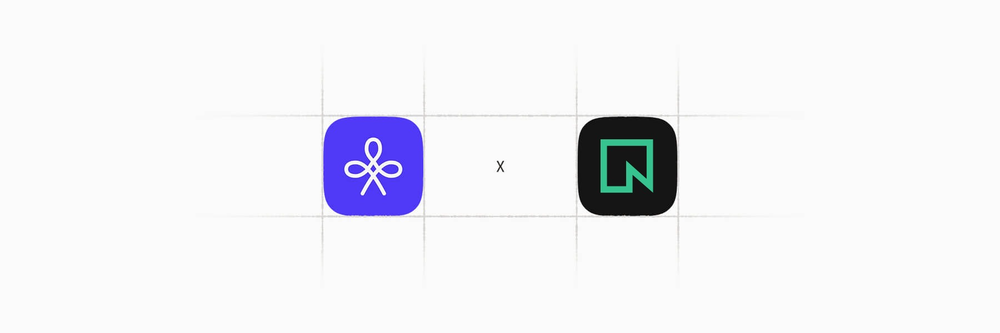

import { APP_PATHS } from '/snippets/appPaths.mdx';

<Frame></Frame>

You can use AutoSend with [Neon](https://neon.com) to:

- send [Managed Better Auth](https://neon.com/docs/auth/overview) emails, such as verification and password reset codes
- sync Managed Better Auth users to AutoSend contacts
- send transactional emails and events from Neon Functions
- store AutoSend email events in Postgres

## Set Up AutoSend

Add and verify a <a href={APP_PATHS.domainConfiguration}>sending domain</a> in AutoSend. You send every email on this page from an address on that domain.

## Send Managed Better Auth Emails

Choose one of two options.

<CardGroup cols={2}>
	<Card title='Custom SMTP' href='/guides/smtp/neon'>
		The simplest option. Managed Better Auth sends its default emails from your address through AutoSend SMTP.
	</Card>
	<Card title='Webhooks' href='https://neon.com/guides/neon-auth-webhooks-nextjs'>
		Full control. Handle the `send.otp` and `send.magic_link` events and send each email with an AutoSend template.
	</Card>
</CardGroup>

With webhooks, Managed Better Auth sends each email as an event to your [webhook](https://neon.com/docs/auth/guides/webhooks) instead of sending the email itself. A `send.otp` event has an `otp_type` and a `send.magic_link` event has a `link_type`, each `sign-in`, `email-verification`, or `forget-password`, so you can map each one to its own AutoSend template. You can reuse the templates from the [Better Auth guide](/guides/better-auth#create-email-templates).

{/* Link the example repo here once it's published: https://github.com/autosendhq/autosend-neon-managed-better-auth-example */}

<Note>
	While a webhook subscribes to `send.otp` or `send.magic_link`, Neon sends those emails to the webhook instead of through SMTP.
</Note>

## Sync Managed Better Auth Users to AutoSend Contacts

Managed Better Auth sends a `user.created` [webhook](https://neon.com/docs/auth/guides/webhooks) event after it creates a user. Your handler can:

1. Call <a href={APP_PATHS.upsertContactApiRef}>Upsert Contact</a> with the user's email and the Managed Better Auth user ID as `userId`.
2. <a href={APP_PATHS.sendEventApi}>Send</a> a `signup_completed` <a href={APP_PATHS.events}>event</a> that starts an onboarding <a href={APP_PATHS.automations}>automation</a>.

{/* Link the example repo here once it's published. It handles user.created in the same webhook handler. */}

## Send Emails with Neon Functions

Send transactional emails from AutoSend templates, and send events that start automations, from a Neon Function.

<Card title='Send emails with Neon Functions' href='/guides/neon-functions'>
	Add the Send email with AutoSend template with `neon functions new autosend-email`.
</Card>

## Store Email Events in Neon

Point an AutoSend <a href={APP_PATHS.webhookIntroduction}>webhook</a> at a Neon Function that stores delivery, bounce, spam, and unsubscribe events in Postgres.

<Card title='Store AutoSend webhook events in Neon' href='https://neon.com/guides/autosend-webhooks'>
	Verify each webhook, store it without duplicates, and test on a branch.
</Card>

<Note>
	Running Better Auth in your own app instead? See our [Better Auth guide](/guides/better-auth).
</Note>
